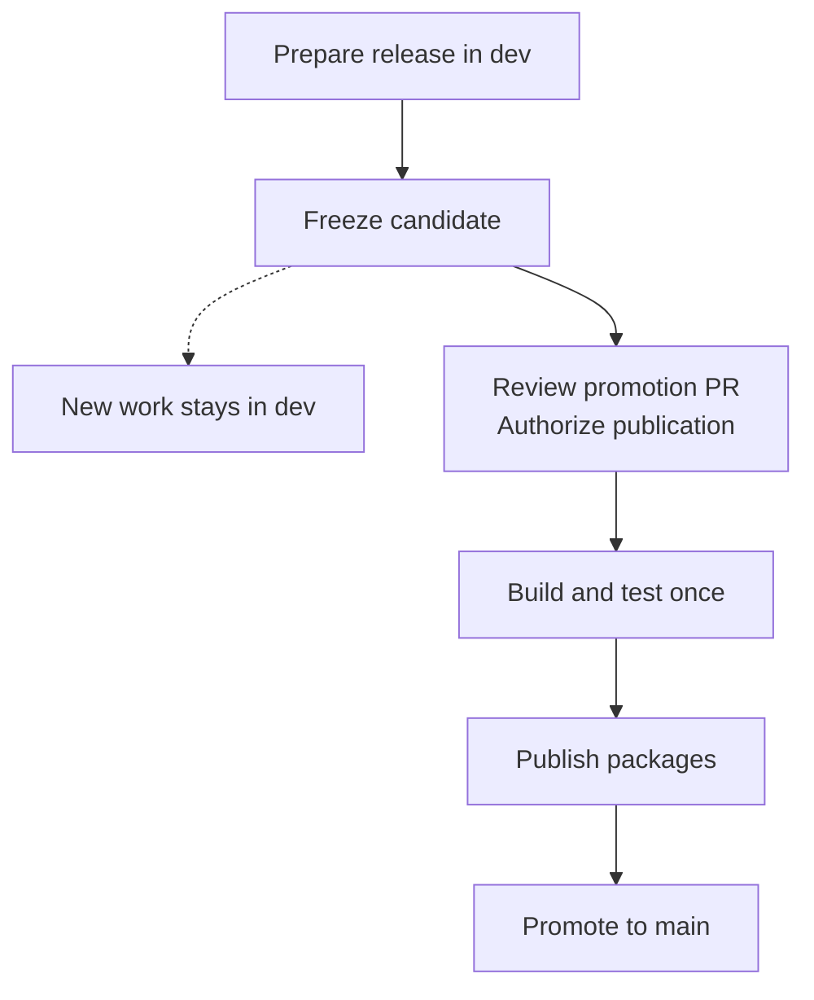
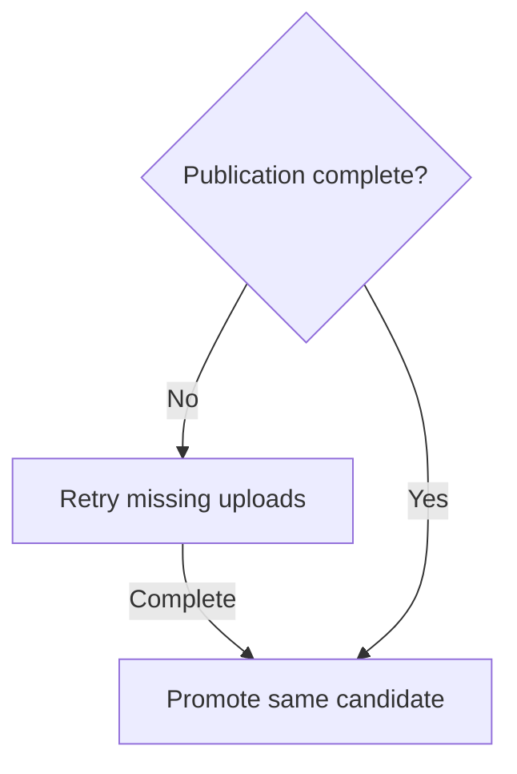

# RFC: Release promotion without backmerge

- Status: Draft for discussion
- Created: 2026-10-21
- Scope: GitHub release automation and public distribution

## Proposal and motivation

Prepare releases in `dev` and promote their exact contents to `main` after publication succeeds. Keep `main` as the latest completed release in the default channel. Implementation starts after agreement on this RFC.

Today, the [release command](../scripts/release.py) creates version and changelog changes on the path to `main`. A separate [backmerge workflow](../.github/workflows/backmerge.yml) returns them to `dev`, and missing commits block the next release. That extra workflow can fail even when publication succeeds.

## Proposed flow

A candidate is a fixed commit selected for publication. Normal code, documentation, and workflow changes enter through `dev`.

The version tag identifies the candidate, which must include the previous normal release. Promotion uses a merge commit to preserve shared history. Its resulting files must match the published candidate exactly. Later changes in `dev` stay outside that release.

`main` can contain promotion merge commits absent from `dev`. The release gate compares content and source history instead of counting commits exclusive to `main`.

Automation must enforce these conditions:

- Review approval and publication authorization apply to the exact candidate. Changed commits or lost approval stop automatic progress.
- Versions, dependency pins, manifests, and release notes agree. The candidate and built packages pass the required CI and installation tests.
- Promotion also requires a successful installation test from the public distribution channels.
- Branch protection blocks promotion until publication succeeds. Automation records the expected `main` commit and stops if it changes unexpectedly.
- Only one beta or stable release remains active, including failed attempts. Maintainers must recover or explicitly abandon it before another starts.

The implementation must preserve the existing [publication safeguards](../.github/workflows/release.yml) and account for [GitHub token event restrictions](https://docs.github.com/en/actions/concepts/security/github_token).

## Failures and distribution limits

PyPI, GitHub Releases, and Git branches cannot update in one transaction. New packages can appear before promotion updates `main`. During that interval, `main` retains the previous completed release.

Retries require the original package files and recorded hashes, which identify file contents. Existing uploads must match those hashes. Missing files or mismatches stop recovery. Automation must not silently rebuild packages, overwrite published versions, or move tags.

Build failures leave `main` unchanged. After publication, a defect requires a new release or an explicit withdrawal procedure. Moving a branch does not undo existing installations.

## Compatibility and exceptions

Package names, shared versioning, exact dependency pins, and public installation routes remain compatible. External consumers continue to choose published versions independently. Their deployment processes remain outside this RFC.

The [installer](../install.sh) currently selects release packages but installs skills without the same version reference. The implementation must provide compatible packages and skills for the selected release. Plugin channels that follow `main` advance after promotion, subject to catalog and client refresh delays.

Alphas remain public packages from `dev`, outside the default installer selection, without advancing `main`. They retain `Unreleased` notes. Beta and stable preparation stamp those notes in `dev`. An alpha-to-beta version change requires a new build and tests.

An urgent fix can use a temporary branch from the published tag when `dev` contains work that cannot ship. The correction must reach `dev` before the next normal release. Its source-history and changelog rules need agreement before activation.

## Tradeoffs and alternatives

| Gain | Cost or limit |
| --- | --- |
| No routine backmerge or its credential dependency | Publication needs persistent state and recovery. |
| Development continues after candidate selection | Preparation and promotion still require separate PRs. |
| `main` contains a completed release | It can temporarily lag behind published packages. |

Fixing the backmerge credential costs less initially but retains synchronization. Integrating development into `main` conflicts with its public-release role. Merging before publication exposes an unpublished version if publication fails. Faster CI and fewer approvals are not guarantees of this proposal.

## Adoption

The [current release guide](../RELEASE.md) remains the operating procedure during review. Implementation PRs follow agreement, starting from a reconciled baseline. Activation must make the required workflows available and prevent the old and new flows from handling the same release.

Before activation, evidence must cover consecutive releases, candidate isolation, partial-upload recovery, promotion retries, and changed approval or branch state. It must also cover alpha selection, package and skill compatibility, and urgent fixes. Reviewing this document does not prove those behaviors.

After activation, remove the obsolete backmerge workflow, script, and tests. Move the guide to `docs/release.md`, update links, and define compatibility for the old path. Broader documentation reorganization remains separate.

## Questions for review

1. Do we accept the interval between package publication and the update to `main`?
2. Do promotion review and explicit publication authorization remain separate human actions?
3. Where do publication state and files persist, and how does a maintainer abandon an incomplete release?
4. Which source-history and changelog rules apply to urgent fixes?
5. How do packages and skills share a supported version reference across installation routes?
